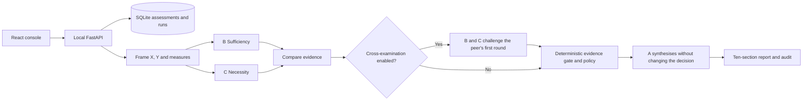

# Architecture

One Uvicorn worker owns the background tasks. A frames the proposal and criteria,
then two fresh agent calls start with the same input via `asyncio.gather`. Neither
gets its peer's output or tools. When enabled, a second parallel call for each agent
receives both completed first-round reviews. No other reviewer rounds run. Each
original input and output is preserved as a run snapshot with status, model,
duration and token counts when provided by the SDK. Cancellation and timeout leave
completed peer outputs intact. Restart marks any interrupted active jobs as failed.
Run history retains earlier runs when an assessment is reviewed again.

The original Chinese `decide()` remains the source of the decision state. A Web
adapter maps it to language-neutral codes. The evidence gate qualifies raw B/C
verdicts before policy evaluation. Verified directional evidence is required for a
binary conclusion, every criterion needs support for Pass, and Fail needs a
verified counterexample on at least one criterion. Unknown citations, invalid
criteria or an unresolved contradiction qualify a binary verdict to Unknown.
These checks validate references and evidence status, not the analytical merits
of the claims. Status “Verified fact” reflects user verification. Comparing
opposing findings surfaces a potential disagreement for review. B and C ask
different logical questions, so their raw verdicts can differ legitimately.

## API

| Method and route | Purpose |
|---|---|
| `GET /api/health` | Mode and configured model |
| `GET /api/demo` | Alarm verification example |
| `POST /api/evidence/parse` | Multipart `file`, returns bounded extracted text |
| `POST /api/assessments` | Validate and save the assessment and evidence registry |
| `GET /api/assessments` | Assessment history and latest status |
| `GET /api/assessments/{id}` | Saved assessment and run summaries |
| `POST /api/assessments/{id}/run` | Start a background run (202) |
| `POST /api/assessments/{id}/cancel` | Request cancellation (202) |
| `GET /api/assessments/{id}/status` | Current progress and audit |
| `GET /api/assessments/{id}/report` | Download-ready JSON for a complete run |

Status and report accept an optional `run_id` query parameter. Full Swagger
schemas can be read at `/openapi.json`.

## Evidence and access

PDF extraction reads text from up to 30 pages. DOCX extraction uses only the main
document XML, validates archive limits and rejects encrypted or macro-enabled
archives. TXT and Markdown use UTF-8. The service caps each upload at 4 MiB and
each extraction at 20,000 characters. The original file is not retained.
Scanned PDFs need OCR outside this app. Extracted UTF-8 text is rendered as text,
sent to agents as untrusted data and never executed. Neither the browser nor the
agents follow source URLs. There are up to 20 registry entries and a 90,000
character combined evidence limit.

This MVP is single-user and binds to loopback by default. It enforces local Host
headers and a local Origin allowlist by default, with no cross-origin credentials.
These measures reduce browser cross-origin exposure and do not authenticate
users. No public port forwarding or shared-host ingress should be added in MVP
mode. The API suppresses request-body validation details and raw provider errors,
and the launchers omit access logs. SDK tracing stays off. SQLite and report
exports contain the submitted evidence and are sensitive files.

For a shared deployment, put all routes behind an authenticated HTTPS gateway,
derive the actor from a trusted session and enforce workspace ownership on every
assessment, document, run and export. Add CSRF protection, per-user limits, audit
access policy, retention/deletion, encrypted backups and an isolated document
parser. Use an external worker with leases for multi-process deployment.
